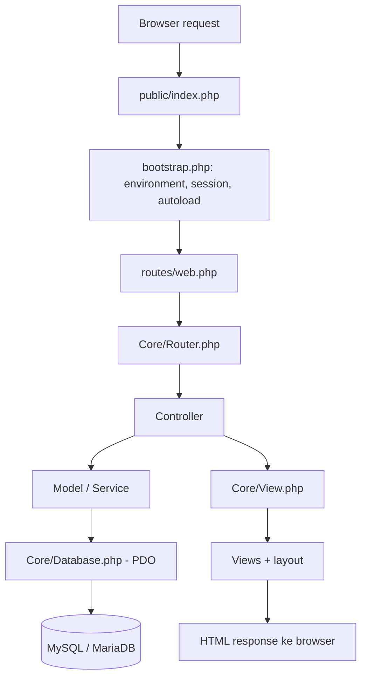

# Panduan arsitektur Web-Berita MVC

## Apa itu MVC?

- **Model**: tahu cara membaca dan menyimpan data database. Contoh: `Article::paginate()`.
- **View**: menggambar HTML dari data yang sudah disiapkan. View tidak melakukan query.
- **Controller**: menerima request, validasi input, memanggil Model/Service, lalu memilih View atau redirect.
- **Router**: menghubungkan nama route dan HTTP method ke Controller.
- **Service**: menjalankan proses khusus lintas fitur, misalnya validasi dan penyimpanan gambar.

MVC bukan sekadar nama folder. Pemisahan ini terlihat ketika query hanya ada di Model, HTML di View, dan alur request di Controller.

## Siklus request



## Contoh 1: pengunjung memilih kategori Budaya

```text
public-header.php
  └─ membuat link ?route=articles.index&category_id=3
       └─ routes/web.php
            └─ ArticleController::index()
                 ├─ Category::find(category_id)
                 └─ Article::paginate(category_id, page)
                      └─ Database::connection() → PDO query
                 └─ View::render('public/articles/index', data)
                      └─ layouts/public.php
                           └─ HTML kartu berita
```

Klik judul artikel mengikuti route `articles.show` dan `ArticleController::show()`, lalu `Article::find()` mengambil artikel detail. Komentar diambil melalui `Comment::forArticle()`, sementara balasan melalui `Comment::repliesForArticle()`.

## Contoh 2: tambah berita di admin

```text
Views/admin/articles/form.php
  └─ POST route admin.articles.store + CSRF token
       └─ routes/web.php
            └─ Admin/ArticleController::store()
                 ├─ requireAdmin()
                 ├─ Csrf::requireValidRequest()
                 ├─ validateArticleInput()
                 ├─ ImageUploadService::store()
                 └─ Article::create(data)
                      └─ PDO prepared INSERT
                 └─ redirect admin.articles.index
```

## Peran file inti

| File | Tanggung jawab |
|---|---|
| `public/index.php` | Satu entry point untuk request browser |
| `bootstrap.php` | Baca `.env`, mulai session, autoload class |
| `routes/web.php` | Peta route dan HTTP method |
| `app/Core/Router.php` | Temukan route, pilih Controller/action |
| `app/Core/Database.php` | Membuat satu koneksi PDO yang digunakan bersama |
| `app/Core/Controller.php` | Helper render, redirect, dan pemeriksaan admin |
| `app/Core/View.php` | Memisahkan render View dari Controller |
| `app/Core/Csrf.php` | Token keamanan untuk form yang mengubah data |
| `app/Models/Article.php` | Query artikel dan JOIN kategori |
| `app/Models/Category.php` | Query dan CRUD kategori |
| `app/Models/Comment.php` | Komentar dan balasan |
| `app/Models/User.php` | Lookup akun untuk login |
| `app/Services/ImageUploadService.php` | Validasi MIME/ukuran dan simpan gambar |
| `app/Views/layouts/public.php` | Layout publik dan stylesheet yang sudah ada |
| `app/Views/layouts/admin.php` | Layout dan navigasi admin bersama |

## Cara mencari kode yang terkait

1. Mulai dari tombol/link yang diklik, lalu cari `href` atau `action` di View.
2. Temukan nama `route` yang dipakai, lalu cari di `routes/web.php`.
3. Buka Controller yang dituju.
4. Cari panggilan Model/Service.
5. Buka method Model untuk melihat SQL.
6. Kembali ke View untuk memahami bagaimana hasil query ditampilkan.

Jangan mulai dengan membaca setiap file dari awal sampai akhir. Pilih satu tindakan pengguna dan ikuti request itu dari awal sampai akhir.

## Batasan desain

Aplikasi ini menggunakan PHP native dengan router query-based untuk menghindari ketergantungan `mod_rewrite`. Ini tetap MVC: route ditangani satu entry point dan controller/model/view terpisah. Refactoring lanjutan dapat menambah testing, logging yang terstruktur, dan validasi yang lebih formal.
